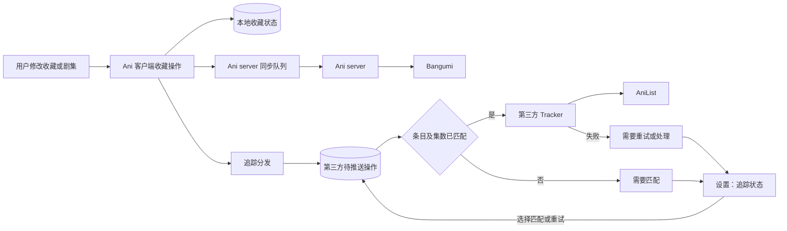

# 条目追踪与第三方同步

## 目标

Ani 是用户修改条目收藏和观看进度的入口。Ani server 负责现有 Ani 账号和 Bangumi 同步；客户端可将同样的修改单向推送到用户配置的第三方追踪服务，AniList 是首个计划接入的目标。一个目标不可用时不应撤销 Ani 的本地操作，也不应影响其他目标。

条目详情页保留现有收藏和剧集操作。账号配置、未成功推送的操作以及条目匹配修正位于设置；不在番剧页面增加第三方服务卡片或编辑器。

## 用户使用流程

1. 在「设置 → 追踪」连接 AniList 账号。Ani 账号与 Bangumi 保持原有登录和同步方式。
2. 像平常一样打开番剧、观看或标记剧集。番剧页面没有追踪器卡片或第三方编辑按钮。
3. Ani 在本地保存操作并加入第三方待推送队列。客户端先检查当前 AniList 账号是否已有用户确认的映射；没有时，用 `bangumi-data` 按 Bangumi ID 查找候选。
4. 找到尚未确认的候选、找不到候选、或集数关系不明确时，操作保持待处理。用户在「设置 → 追踪 → 需要处理」看到番剧和原因，可查看建议、搜索 AniList 或输入 AniList ID，选择正确作品并确认。跨季度合并等编号不明确的情况还需要确认有效的集数对应；只确认作品 ID 不会自动启用未知的编号转换。
5. 匹配与编号关系可用后，客户端将约定的进度推送到 AniList。此后同一账号在同一设备更新同一条目，无需重复确认。网络失败时设置页显示待重试；账号失效时提示重新登录。
6. 换设备并重新登录 AniList 后，远端列表仍在；本地确认的映射和未发送操作不会自动恢复。新设备需要重新确认，除非后续实现经确认的跨设备保存。

以上是目标体验；当前 PR 尚未实现账号设置、候选查询、待处理队列、匹配确认或 AniList 推送。

## 系统边界

图中第三方队列、匹配、设置和 AniList 是目标设计；本阶段实现通用接口、内存分发和剧集事件入口。Ani server 侧的能力和数据归属仍需维护者确认。图中的本地操作和待推送操作需要事务或等价的可恢复机制才能保证崩溃后不丢失，当前内存分发不提供该保证。

## 通用接口

`Tracker` 表示一个已启用的追踪目标，拥有稳定 ID，并接受 `TrackingChange`。变更使用 Ani 的 `subjectId`、剧集 ID 和 `UnifiedCollectionType`，不暴露第三方 API 的数据类型。`TrackingChange` 区分剧集批量变更与条目收藏变更；目标负责将 Ani 的身份和状态转换成自身的表示。

`TrackingDispatcher` 按注册顺序将变更交给每个目标。一个目标抛出普通异常时，分发器报告目标 ID 和异常，并继续调用其他目标；协程取消向上传播。目标 ID 不能为空或重复。当前分发在调用协程内顺序执行，不提供并行、持久化、后台调度或重试；调用者必须避免将慢网络调用放在会阻塞用户操作的路径上。

`EpisodeCollectionRepository` 在写入本地剧集状态和 Ani server 待同步操作后，向可选的分发器发送一条变更。单集操作包含一个剧集 ID；全部标记已看包含本次操作的剧集 ID 列表。未配置分发器时沿用现有行为。当前没有注册生产追踪目标；条目收藏变更的类型已定义，调用点尚未接入。

`Tracker` 当前只定义推送入口。账号授权、匹配查询、用户设置和待处理队列属于后续实现；接口不要求在条目页面直接读取或编辑第三方状态，也不将凭据放入变更对象。现有 Ani/Bangumi 同步路径不得作为额外客户端目标重复注册。Ani 是否也实现 `Tracker` 由维护者确认，不能因此产生第二次写入。

## 推送流程

1. 用户在 Ani 修改收藏或剧集状态，Ani 将本地状态和自身服务端待同步操作写入现有路径。
2. 第三方同步记录用户操作，按目标、账号及条目标识查找待推送状态。目标可以不可用，但不能让 Ani 本地写入回滚。
3. 根据已确认的 Ani/Bangumi 条目 ID 到第三方媒体 ID 的关系，验证剧集编号是否可转换。没有可信匹配、匹配冲突或编号无法转换时，保留待处理状态并在设置中提示用户处理，不猜测目标。
4. 目标读取必要的远端状态并推送约定字段。重试或较早事件不得覆盖更新的远端进度。成功后只确认已发送的版本，期间到达的新操作继续保留。
5. 网络错误与限流等待重试；账号失效或匹配问题提供可操作的提示。每个目标的失败独立处理。重试需要考虑重复投递和远端已成功但响应丢失的情况。

第一阶段仅建立内存分发的入口，不保证上述持久化推送语义。上线第三方目标前需实现并测试可恢复投递、并发顺序和用户可见状态。

## 条目匹配与保存

### 本设计采用的首版方案

Ani 的条目 ID 来自 Bangumi；AniList 使用自己的媒体 ID。首版使用 `bangumi-data` 中同一条记录的 `bangumi` 和 `aniList` ID **生成候选，而不是直接授权自动绑定或推送**。客户端按 Bangumi ID 查候选，并在设置的待处理项中优先展示候选供用户确认；没有候选时允许搜索或输入 AniList ID。已有的用户确认关系优先于数据集候选。

实验使用 [`bangumi-data` 0.3.234](https://cdn.jsdelivr.net/npm/bangumi-data@0.3.234/dist/data.json)：部分不同 Bangumi 条目指向同一 AniList ID，且发现日期或作品名称不一致的可疑关系。记录同时包含两个 ID 不是身份正确的证明。首版对每个尚未确认的候选要求用户确认；跨站 ID 也不证明逐集对应，拆分季度、合集、OVA、剧场版和特别篇无法安全换算时保留待处理。该选择是本 PR 的设计提案，尚未实现，也不是维护者对数据源的认可。

共享候选数据以版本化快照管理，可缓存并刷新；用户确认或修正单独保存，键至少包含目标服务、AniList 账号 ID 和 Ani 条目 ID。首版提议将用户关系保存在客户端，换设备需重新确认；不将 token 写入映射或普通备份。客户端如何分发、更新和校验快照，需要依据维护者接受的数据源和许可决定，不能假定现有订阅代理或服务器接口可用。

Ani server 若已提供可信的 ID 关系，可作为候选来源；是否由服务端维护共享数据或保存用户修正，是单独的服务端设计。若将来允许自动采用某些关系，需先定义可信度、纠错和集数映射规则，不能直接把 `bangumi-data` 的候选标成已确认。

## 决策与确认人

下列事项区分 fork 方案的所有者决定、上游接纳和服务端事实；此前的讨论不等于所有人已批准实现。

**由 fork 所有者 haru 审阅和决定**

- 是否接受上述首版体验：`bangumi-data` 只提供候选，首次在设置中确认，本地保存，换设备重新确认？如不接受，需要决定自动匹配或跨设备恢复的替代方案。
- 首版具体推送哪些字段；远端进度更高、撤销和切换账号时如何处理？首批支持哪些平台？
- 是否要求 AniList 第一个可用版本同时具备持久化重试及设置中的失败队列？

**向 Animeko 上游维护者确认，影响上游接纳，不阻止 fork 中的设计审阅**

- 通用 `Tracker` 是否应包含 Ani 实现，还是只代表第三方目标？Ani/Bangumi 现有路径如何保持唯一？
- 是否接受设置中的匹配确认、首版字段范围、持久化队列，以及 `bangumi-data` 作为候选来源和相关许可要求？
- 项目方是否注册和维护 AniList OAuth 客户端，以及要求支持哪些平台？

**向 Ani server 维护者核实，影响服务端方案，不作为已存在能力**

- 服务端当前是否提供 Bangumi 到 AniList 的条目或逐集映射？如果没有，是否愿意维护或提供版本化共享候选？
- 是否存在适合保存用户映射的已认证跨设备接口；若无，是否接受另行设计？数据校验、更新、许可与纠错由谁负责？

开发者可直接准备问题和 fork PR；向他人发布评论或发送消息需要所有者明确指示。

## 验证

当前接口的测试覆盖多目标失败隔离、取消传播、目标 ID 唯一性，以及单集和批量剧集事件与 Ani server 本地待同步操作的共存。后续目标上线前还需覆盖持久化、重启、重复投递、账号切换、限流、无匹配、错误匹配、分季编号和真实平台登录与推送。
